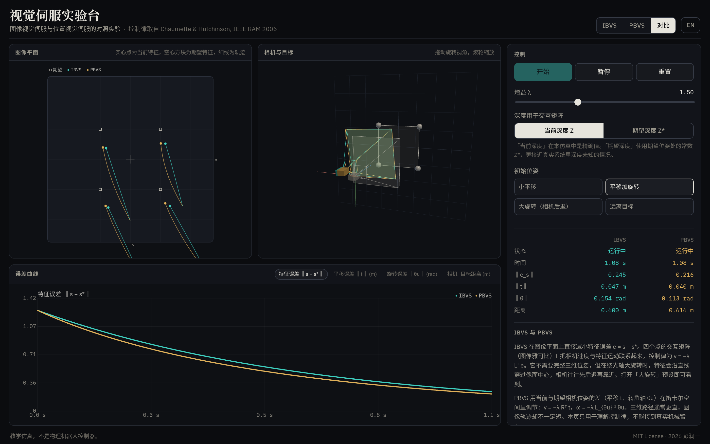

# 视觉伺服实验台 · Visual Servo Lab

浏览器里即可运行的 **IBVS / PBVS** 对照实验台：针孔相机、四个共面目标点、正确的交互矩阵与位姿控制律、图像平面轨迹、三维场景和误差曲线。不需要 ROS、MATLAB 或真实机械臂。

[English version below](#visual-servo-lab)

**在线演示（GitHub Pages）：** <https://pengrunyi.github.io/visual-servo-lab/>



> 上图在「对比」模式下拍摄。若要更新：执行 `npm run dev`，切到「对比」并按「开始」，将全窗口截图保存为 `docs/screenshot.png`。

## 这是什么

视觉伺服（visual servoing）用图像把相机（或手眼机器人）送到期望位姿。两条经典路线是：

- **IBVS**（图像视觉伺服）：在图像平面上直接减小特征误差；
- **PBVS**（位置视觉伺服）：先得到当前与期望位姿的差，再在笛卡尔空间里调节。

现有开源材料大多是 MATLAB/Simulink、MuJoCo/Python、ROS，或只实现其中一种方法。本项目把两条控制律放到同一页、同一初始条件里对照，点开就能看。

本实验台实现的是 Chaumette 与 Hutchinson 在 *IEEE Robotics & Automation Magazine*（2006）Part I 中给出的标准点特征表述，而不是对某个课程仓库的改写。

## 功能

- 针孔相机 + 四个共面角点（正方形目标）
- 可切换 **IBVS**、**PBVS**，或 **对比**（同一初始条件并行）
- 图像平面：当前 / 期望特征与特征轨迹
- 三维场景：相机锥体与目标（可旋转、缩放）
- 误差曲线：特征误差、平移误差、旋转误差、相机–目标距离
- 增益 λ、IBVS 深度近似（当前 Z 或期望 Z*）、四组初始位姿（含展示 IBVS「相机后退」的大旋转）
- 中文界面，可切换 English
- 纯前端，可部署到 GitHub Pages

## 本地运行

需要 Node.js 18 或更高版本。

```bash
git clone https://github.com/Pengrunyi/visual-servo-lab.git
cd visual-servo-lab
npm install
npm run dev
```

浏览器打开终端里提示的地址（默认 <http://localhost:5173/visual-servo-lab/>）。空格键开始 / 暂停，`R` 重置。

```bash
npm test          # 运行 Vitest 单元测试
npm run build     # 类型检查并打包到 dist/
npm run preview   # 预览生产构建
```

## 发布到 GitHub Pages

1. 在 GitHub 上建立名为 `visual-servo-lab` 的空仓库（用户名若为 `Pengrunyi`，演示地址即为上面的链接）。
2. 把本仓库推上去，默认分支使用 `main`。
3. 仓库 **Settings → Pages → Source** 选 **GitHub Actions**。
4. 推送后，工作流 `.github/workflows/pages.yml` 会运行测试、构建并发布。

Vite 的 `base` 已设为 `/visual-servo-lab/`，与 `https://pengrunyi.github.io/visual-servo-lab/` 一致。若仓库名或用户名不同，请同时修改 `vite.config.ts` 里的 `base` 和本说明中的地址。

## 控制律（简述）

相机约定为计算机视觉坐标系：+Z 向前，X 向右，Y 向下。图像特征使用归一化坐标 \((x, y) = (X/Z,\, Y/Z)\)。相机速度 \(v_c = (v,\,\omega)\) 在当前相机坐标系中表示，位姿用右乘的 SE(3) 指数映射积分：\(T \leftarrow T\,\mathrm{Exp}(\xi\,\Delta t)\)。

### IBVS

对单个点，交互矩阵（图像雅可比）为

\[
L(s,Z)=\begin{bmatrix}
-1/Z & 0 & x/Z & xy & -(1+x^2) & y \\
0 & -1/Z & y/Z & 1+y^2 & -xy & -x
\end{bmatrix}.
\]

四个点堆叠成 \(8\times 6\) 矩阵。特征误差 \(e = s - s^*\)，控制律

\[
v_c = -\lambda\, L^+ e,
\]

其中 \(L^+\) 是 Moore–Penrose 伪逆。深度 \(Z\) 可选当前真实深度，或期望位姿处的常数 \(Z^*\)（深度未知时的常用近似）。

### PBVS

记 \(^{c*}T_c = T_{\mathrm{desired}}^{-1} T_{\mathrm{current}}\)，平移为 \(t\)，旋转的转角轴为 \(\theta u = \mathrm{Log}(^{c*}R_c)\)。当前相机系下的控制律为

\[
v = -\lambda\,(^{c*}R_c)^\top t, \qquad
\omega = -\lambda\, L_{\theta u}^{-1}\,\theta u.
\]

\(L_{\theta u}\) 取自同一篇论文。目标静止时，这等价于把物体位姿调节到期望值。

### 相机后退

IBVS 会让图像特征沿近似直线走向期望位置。当初始相对期望有绕光轴的大旋转时，这些直线经过像面中心，相机往往会先后退再靠近。界面里的「大旋转（相机后退）」预设就是为此准备的；把误差曲线切到「相机–目标距离」可以看得更清楚。PBVS 在笛卡尔空间里走更直的路径，一般不会出现同样的后退。

## 声明

**本项目是教学仿真，不是物理机器人控制器。** 它不包含标定、手眼关系、关节限位、碰撞检测或真实相机驱动，不能直接接到机械臂上使用。

## 参考文献

- F. Chaumette and S. Hutchinson, “Visual servo control, Part I: Basic approaches,” *IEEE Robotics & Automation Magazine*, vol. 13, no. 4, pp. 82–90, Dec. 2006. [doi:10.1109/MRA.2006.250573](https://doi.org/10.1109/MRA.2006.250573)
- F. Chaumette and S. Hutchinson, “Visual servo control, Part II: Advanced approaches,” *IEEE Robotics & Automation Magazine*, vol. 14, no. 1, pp. 109–118, Mar. 2007. [doi:10.1109/MRA.2007.339609](https://doi.org/10.1109/MRA.2007.339609)
- P. I. Corke, *Robotics, Vision and Control*, 2nd ed. Springer, 2017, ch. 15 (Visual servoing).
- S. Hutchinson, G. D. Hager, and P. I. Corke, “A tutorial on visual servo control,” *IEEE Transactions on Robotics and Automation*, vol. 12, no. 5, pp. 651–670, Oct. 1996. [doi:10.1109/70.538972](https://doi.org/10.1109/70.538972)

## 许可

[MIT License](LICENSE) © 2026 彭润一 / Peng Runyi

---

# Visual Servo Lab

A browser-based laboratory that compares **image-based (IBVS)** and **position-based (PBVS)** visual servoing: a pinhole camera, four coplanar target points, the standard interaction-matrix and pose-error control laws, an image-plane view with feature trajectories, a 3D scene, and error plots. No ROS, MATLAB, or physical arm is required.

**Live demo (GitHub Pages):** <https://pengrunyi.github.io/visual-servo-lab/>


> The image above was taken in Compare mode. To refresh it, run `npm run dev`, switch to Compare, press Start, and save a full-window capture as `docs/screenshot.png`.

## Why this exists

Most open teaching material for visual servoing is MATLAB/Simulink, a MuJoCo or Python script, a ROS package, or an IBVS-only demo. The gap is a one-click, bilingual page that puts both laws on the same initial condition, with the image plane, a 3D view, and error curves visible at once.

The algorithms follow the classical point-feature treatment in Chaumette & Hutchinson, *IEEE Robotics & Automation Magazine*, 2006, Part I — they are not copied from another course repository.

## Features

- Pinhole camera and a square of four coplanar points
- Switch **IBVS**, **PBVS**, or **Compare** (both, same initial condition)
- Image plane: current vs desired features and trajectories
- 3D scene of the camera frustum and the target (orbit / zoom)
- Plots of feature error, translation error, rotation error, and camera–target distance
- Gain \(\lambda\), IBVS depth approximation (current \(Z\) or desired \(Z^*\)), and four initial-pose presets, including a large rotation that exhibits IBVS camera retreat
- Chinese-first UI with an English toggle
- Static site, ready for GitHub Pages

## Run locally

Node.js 18+ is required.

```bash
git clone https://github.com/Pengrunyi/visual-servo-lab.git
cd visual-servo-lab
npm install
npm run dev
```

Open the URL printed by Vite (default <http://localhost:5173/visual-servo-lab/>). Space starts or pauses the motion; `R` resets.

```bash
npm test          # Vitest unit tests
npm run build     # typecheck and write dist/
npm run preview   # preview the production build
```

## GitHub Pages

1. Create an empty GitHub repository named `visual-servo-lab` (with username `Pengrunyi` the demo URL is the one above).
2. Push this project, using `main` as the default branch.
3. In **Settings → Pages → Source**, choose **GitHub Actions**.
4. On each push, `.github/workflows/pages.yml` runs the tests, builds the site, and deploys it.

`base` in `vite.config.ts` is already `/visual-servo-lab/`, which matches `https://pengrunyi.github.io/visual-servo-lab/`. If the repository or user name differs, change `base` and the URLs in this README together.

## Control laws (short)

The camera uses the computer-vision convention: \(+Z\) forward, \(X\) right, \(Y\) down. Features are normalized coordinates \((x, y) = (X/Z,\, Y/Z)\). The camera twist \(v_c = (v,\,\omega)\) is expressed in the current camera frame and integrated with the right (body-fixed) SE(3) exponential: \(T \leftarrow T\,\mathrm{Exp}(\xi\,\Delta t)\).

### IBVS

For one point the interaction matrix is

\[
L(s,Z)=\begin{bmatrix}
-1/Z & 0 & x/Z & xy & -(1+x^2) & y \\
0 & -1/Z & y/Z & 1+y^2 & -xy & -x
\end{bmatrix}.
\]

Four points stack into an \(8\times 6\) matrix. With feature error \(e = s - s^*\),

\[
v_c = -\lambda\, L^+ e,
\]

where \(L^+\) is the Moore–Penrose pseudo-inverse. Depth \(Z\) may be the current (exact, in this simulation) value or the constant \(Z^*\) taken at the desired pose — the usual approximation when true depth is unknown.

### PBVS

Let \(^{c*}T_c = T_{\mathrm{desired}}^{-1} T_{\mathrm{current}}\), with translation \(t\) and angle-axis \(\theta u = \mathrm{Log}(^{c*}R_c)\). In the current camera frame

\[
v = -\lambda\,(^{c*}R_c)^\top t, \qquad
\omega = -\lambda\, L_{\theta u}^{-1}\,\theta u.
\]

\(L_{\theta u}\) is the rotation interaction matrix from the same paper. Because the object is static, this is equivalent to regulating the object's pose to its desired pose.

### Camera retreat

IBVS drives image features along roughly straight lines toward their desired locations. For a large rotation about the optical axis those lines pass near the principal point, so the camera often moves backward and then returns. The “Large rotation (camera retreat)” preset is there to show this; switch the plot to camera–target distance to see it clearly. PBVS, which takes a straighter path in Cartesian space, does not usually retreat in the same way.

## Disclaimer

**This is a teaching simulation, not a physical robot controller.** It does not include calibration, hand–eye transforms, joint limits, collision checking, or a real camera driver, and must not be wired to a manipulator as-is.

## References

- F. Chaumette and S. Hutchinson, “Visual servo control, Part I: Basic approaches,” *IEEE Robotics & Automation Magazine*, vol. 13, no. 4, pp. 82–90, Dec. 2006. [doi:10.1109/MRA.2006.250573](https://doi.org/10.1109/MRA.2006.250573)
- F. Chaumette and S. Hutchinson, “Visual servo control, Part II: Advanced approaches,” *IEEE Robotics & Automation Magazine*, vol. 14, no. 1, pp. 109–118, Mar. 2007. [doi:10.1109/MRA.2007.339609](https://doi.org/10.1109/MRA.2007.339609)
- P. I. Corke, *Robotics, Vision and Control*, 2nd ed. Springer, 2017, ch. 15 (Visual servoing).
- S. Hutchinson, G. D. Hager, and P. I. Corke, “A tutorial on visual servo control,” *IEEE Transactions on Robotics and Automation*, vol. 12, no. 5, pp. 651–670, Oct. 1996. [doi:10.1109/70.538972](https://doi.org/10.1109/70.538972)

## License

[MIT License](LICENSE) © 2026 Peng Runyi / 彭润一
